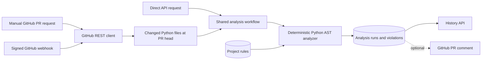

# Invariant

Invariant is a backend developer tool for enforcing project-specific software
architecture rules. A team records boundaries such as “domain code must not
import infrastructure,” then submits source changes or a GitHub pull request.
Invariant returns deterministic, machine-readable violations and keeps an audit
history of every completed analysis.

Version 0.2 is intentionally focused: it analyzes Python imports with the
standard-library AST. It does **not** claim semantic or AI-based architecture
understanding, and the human developer remains the final authority.

## Architecture



- **FastAPI** exposes projects, rules, analysis, history, health, and webhook APIs.
- **SQLAlchemy 2 + PostgreSQL 18** persist project configuration, rules, runs,
  and individual violations.
- **Alembic** migrates v0.1 data forward without resetting the database.
- **httpx** contains all GitHub REST networking in `app/github.py`.
- The shared analysis workflow in `app/analysis_service.py` is independent of
  whether source files came from an HTTP body, GitHub, or a future client.
- The core analyzer never executes submitted code.

## Data model

- A **Project** has a unique name and optional paired `github_owner` /
  `github_repo` configuration. Existing v0.1 projects remain valid with both
  fields null and can be configured later.
- A **Rule** belongs to one project. v0.2 supports `forbidden_import` rules.
- An **AnalysisRun** records its source (`direct`, `github_pr`, or
  `github_webhook`), status, pass/fail result, repository/PR metadata, counts,
  and creation time.
- An **AnalysisViolation** snapshots the rule name and diagnostic location so
  history remains useful independently of future rule changes.

## How rules work

For each submitted `.py` file, Invariant converts its path to a module name:

```text
app/domain/payment.py -> app.domain.payment
```

A rule applies when that module matches its `source_pattern` glob. The AST
walker collects `import` and `from ... import ...` statements. An import
violates a rule when it equals a forbidden module or starts with that module
prefix. Results are sorted by path, line, column, and rule ID, making repeated
analysis deterministic.

Example rule:

```json
{
  "name": "domain isolation",
  "rule_type": "forbidden_import",
  "source_pattern": "app.domain.*",
  "forbidden_imports": ["app.infrastructure", "fastapi"]
}
```

`from app.infrastructure.db import repository` inside
`app/domain/payment.py` produces a structured violation with the rule, path,
line, column, imported module, and explanation.

## Local development

Requirements:

- [uv](https://docs.astral.sh/uv/)
- Docker with Compose

```bash
cp .env.example .env
uv sync --dev
docker compose up -d db
uv run alembic upgrade head
uv run fastapi dev app/main.py
```

The API is available at <http://127.0.0.1:8000>, with interactive documentation
at <http://127.0.0.1:8000/docs>.

PostgreSQL listens on `5432` inside its container and maps to host port `5433`
by default, avoiding a common conflict with host PostgreSQL installations. Set
`POSTGRES_PORT` in `.env` if 5433 is occupied.

### Environment variables

| Variable | Default | Purpose |
| --- | --- | --- |
| `DATABASE_URL` | unset | Complete SQLAlchemy URL; overrides all `POSTGRES_*` values |
| `POSTGRES_DB` | `invariant` | Database name |
| `POSTGRES_USER` | `invariant` | Database user |
| `POSTGRES_PASSWORD` | `invariant` | Local development password |
| `POSTGRES_HOST` | `localhost` | Database host for local app execution |
| `POSTGRES_PORT` | `5433` | Database port for local app execution / host mapping |
| `GITHUB_TOKEN` | unset | Optional for public repositories; required for private repositories and PR comments |
| `GITHUB_WEBHOOK_SECRET` | unset | Shared secret used to verify GitHub webhook signatures |
| `GITHUB_POST_PR_COMMENT` | `false` | Post concise PASS/violation comments when a token is also present |
| `GITHUB_API_URL` | `https://api.github.com` | Override for GitHub Enterprise Server or tests |
| `APP_PORT` | `8000` | Host port used by the Compose app service |

Never commit `.env`. It is ignored, while `.env.example` contains placeholders
and local-only example credentials.

## Docker full stack

Build the application image, start PostgreSQL, migrate, and run FastAPI:

```bash
cp .env.example .env
docker compose up --build
```

The app container waits for a healthy database, runs `alembic upgrade head`,
and connects to PostgreSQL through Compose service DNS at `db:5432`. The image
runs as an unprivileged `invariant` user.

Useful commands:

```bash
docker compose ps
docker compose logs app db
docker compose down
```

`docker compose down` preserves the named PostgreSQL volume. Do not add `-v` if
you want to keep local data.

## Migrations

```bash
uv run alembic upgrade head
uv run alembic current
uv run alembic check
```

The v0.2 migration adds nullable GitHub fields to existing projects, then creates
analysis run and violation tables. It does not delete or rewrite v0.1 project or
rule data.

## API

### Projects and rules

```bash
curl -X POST http://127.0.0.1:8000/projects \
  -H "Content-Type: application/json" \
  -d '{
    "name": "payments",
    "description": "Payments service",
    "github_owner": "example-org",
    "github_repo": "payments"
  }'

curl http://127.0.0.1:8000/projects
curl http://127.0.0.1:8000/projects/1
```

Associate an existing v0.1 project with GitHub, or clear both fields with null:

```bash
curl -X PATCH http://127.0.0.1:8000/projects/1 \
  -H "Content-Type: application/json" \
  -d '{"github_owner":"example-org","github_repo":"payments"}'
```

Add and list rules:

```bash
curl -X POST http://127.0.0.1:8000/projects/1/rules \
  -H "Content-Type: application/json" \
  -d '{
    "name":"domain isolation",
    "source_pattern":"app.domain.*",
    "forbidden_imports":["app.infrastructure"]
  }'

curl http://127.0.0.1:8000/projects/1/rules
```

### Direct code analysis

```bash
curl -X POST http://127.0.0.1:8000/projects/1/analyze \
  -H "Content-Type: application/json" \
  -d '{
    "files":[{
      "path":"app/domain/payment.py",
      "content":"from app.infrastructure.db import repository\n"
    }]
  }'
```

Direct analysis now returns and persists an analysis run while preserving the
v0.1 summary and violation fields:

```json
{
  "id": 42,
  "project_id": 1,
  "source": "direct",
  "status": "completed",
  "passed": false,
  "pull_number": null,
  "repository_owner": "example-org",
  "repository_name": "payments",
  "files_analyzed": 1,
  "rules_evaluated": 1,
  "violation_count": 1,
  "created_at": "2026-09-06T08:00:00Z",
  "violations": [{
    "id": 73,
    "analysis_run_id": 42,
    "rule_id": 1,
    "rule_name": "domain isolation",
    "path": "app/domain/payment.py",
    "line": 1,
    "column": 1,
    "imported_module": "app.infrastructure.db",
    "message": "app.domain.payment must not import app.infrastructure (matched app.infrastructure.db)"
  }]
}
```

Malformed Python returns a structured `422 invalid_python` response and does not
create a completed analysis run.

### Manual GitHub pull request analysis

The project must have GitHub owner/repository configuration:

```bash
curl -X POST http://127.0.0.1:8000/projects/1/analyze/github \
  -H "Content-Type: application/json" \
  -d '{"pull_number":12}'
```

Invariant fetches PR metadata and the changed-file list through GitHub's REST
API, downloads each eligible file at the PR head SHA, runs the shared AST
analyzer, persists the result, and returns the full run. Deleted files and
non-Python files are skipped.

GitHub 404s, rate limits, authorization failures, malformed responses, and
network failures are translated to structured API errors without exposing
credentials or upstream payloads.

### Analysis history

```bash
curl http://127.0.0.1:8000/projects/1/analysis-runs
curl http://127.0.0.1:8000/analysis-runs/42
```

The project endpoint returns newest-first summaries. The global run endpoint
returns the summary plus persisted violations. Missing projects or runs return
404.

## GitHub webhook

Configure a strong random `GITHUB_WEBHOOK_SECRET`, then add a GitHub repository
webhook targeting:

```text
POST https://your-invariant-host/integrations/github/webhook
Content type: application/json
Events: Pull requests
```

Invariant validates `X-Hub-Signature-256` with HMAC-SHA256 and constant-time
comparison before parsing or acting on the payload. It analyzes pull request
actions `opened`, `synchronize`, and `reopened`; other events/actions return a
clean `202 ignored` response.

For relevant events, repository owner/name selects the configured project. The
`X-GitHub-Delivery` value is persisted with a unique constraint, so retrying the
same delivery returns the existing run instead of creating a duplicate. Manual
and webhook-triggered PR analyses use the same code path.

### Optional PR feedback

Set both values below to opt in:

```dotenv
GITHUB_TOKEN=github-token-with-repository-comment-permission
GITHUB_POST_PR_COMMENT=true
```

Invariant posts either `Invariant: PASS` or a concise violation list. A comment
failure is logged without secrets and does not roll back or fail the completed
analysis. GitHub Check Runs are intentionally out of scope for v0.2.

## Testing and quality checks

External GitHub calls are mocked; tests require no token and do not mutate a
GitHub repository. SQLite provides fast per-test isolation, while PostgreSQL and
container behavior should be verified separately.

```bash
uv sync --dev
uv run pytest
uv run ruff check app migrations tests
uv run ruff format --check app migrations tests
uv run python -m compileall -q app migrations tests
```

Real local verification:

```bash
docker compose up -d db
uv run alembic upgrade head
uv run alembic current
uv run alembic check
uv run uvicorn app.main:app --host 127.0.0.1 --port 8000
```

## Security and limitations

- No GitHub token or webhook secret is stored in PostgreSQL.
- Webhook signatures are checked against the exact raw body before JSON parsing.
- Invariant never executes submitted or downloaded code.
- GitHub content is limited to changed, non-deleted `.py` files that decode as
  UTF-8 and are at most 1 MB. GitHub exposes at most 3,000 changed files for one
  pull request through this REST endpoint.
- Analysis is synchronous and currently supports only Python forbidden-import
  rules and absolute module prefixes.
- Relative imports are parsed but are not resolved into absolute package names.
- The service has no authentication, organizations, authorization model, web UI,
  background queue, or deployment hardening yet. Do not expose it publicly
  without an appropriate trusted network boundary.
- Repository-wide unchanged files are not analyzed; v0.2 evaluates changed PR
  files only.

## Roadmap

Potential v0.3+ work belongs here rather than in the v0.2 implementation:

- GitHub App authentication and GitHub Checks.
- Semantic / LLM-assisted architecture rules with human review.
- Repository-wide dependency graphs and additional deterministic rule types.
- CI and CLI integrations.
- Multi-language analysis.
- Authentication, organizations, and authorization.
- Web UI and production deployment guidance.
