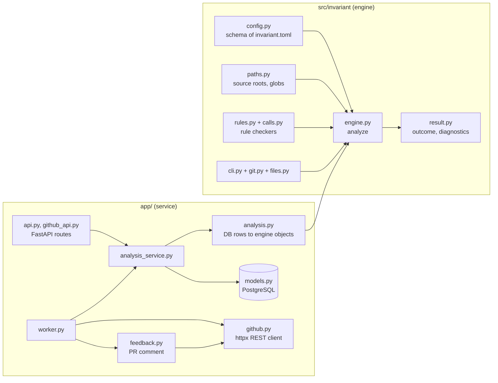
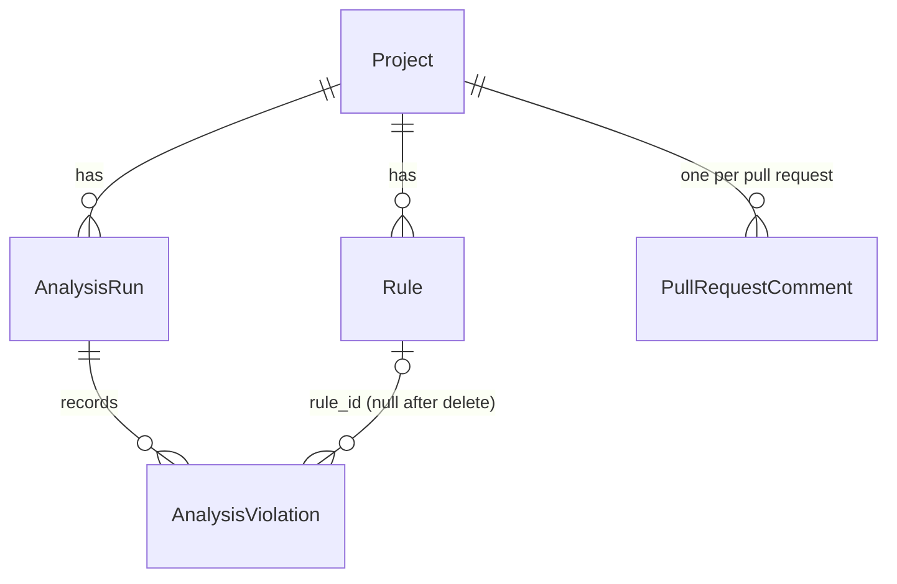
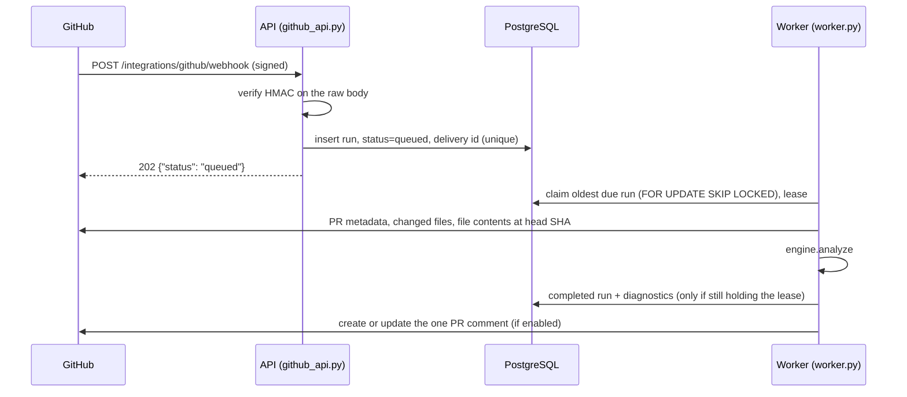

# 1. Architecture

Invariant checks Python code against architecture rules that a team writes
down, such as "the domain layer must not import the infrastructure layer".
It reads the code with Python's `ast` module and never runs it. The same
check can be started in three ways:

- the **`invariant` command** on a developer machine or in CI, offline;
- the **HTTP API**, which stores projects, rules and every result;
- a **GitHub pull request**, analyzed by a background worker and answered
  with one comment on the pull request.

## The two halves of the repository

```text
src/invariant/   the engine and the CLI       -> the installable wheel
app/             the API service and worker    -> runs from a checkout or the Docker image
migrations/      Alembic database migrations   (used by app/)
tests/           pytest suite for both halves
examples/demo/   a tiny project the CLI tests check
scripts/         CI helpers: Compose smoke test, stand-in GitHub, limit measurement
```

The split is deliberate. The wheel (`pip install invariant`) contains only
`src/invariant` and depends only on pydantic, so CI jobs that run
`invariant check` need no database or web framework. The service's
dependencies (FastAPI, SQLAlchemy, psycopg, httpx, Alembic) are the `server`
dependency group in `pyproject.toml`, which `uv sync` installs by default.

The repository checks its own engine with its own rules: the
[`invariant.toml`](../../invariant.toml) at the root forbids `src/invariant`
from importing `app`, FastAPI, SQLAlchemy and the rest, and from calling
`eval`, `exec` or `importlib.import_module`. CI runs `invariant check .`, so
breaking the boundary fails the build.

## Components



### The engine, `src/invariant`

| Module | Responsibility |
| --- | --- |
| `config.py` | Pydantic models of `invariant.toml`: `InvariantConfig`, `ProjectSettings`, one model per rule type. The API validates rules with the same models, so a rule means the same thing everywhere. |
| `paths.py` | Normalises repository paths, maps a file to a module name through the source roots, matches path globs. |
| `engine.py` | `analyze(sources, rules, settings)`: parses each file once, runs every applicable rule, collects diagnostics, decides the outcome. Files it cannot read come in as `Unreadable` and make the result `incomplete`. |
| `rules.py` | One checker per rule type (`forbidden_import`, `no_relative_import`, `max_file_lines`, `forbidden_call`), registered in `CHECKERS`. |
| `calls.py` | Resolves the name a call is made through back to an import or a builtin, with Python's scoping rules, for `forbidden_call`. |
| `result.py` | `AnalysisResult`, `Diagnostic`, `Outcome` (`pass`, `fail`, `incomplete`, `not_applicable`) and the JSON result format (`schema_version` 1). |
| `cli.py` | `invariant init` and `invariant check`; text and JSON output; exit codes. |
| `files.py`, `git.py` | Read files from a directory, or the changed files of a Git range, with the same size and encoding rules as the GitHub path. |

The engine is pure: give it file contents and rules, get a result. It does
no I/O of its own, which is why the API, the worker and the CLI can share it.

### The service, `app/`

| Module | Responsibility |
| --- | --- |
| `main.py` | `create_app()`: builds the FastAPI application, adds the middleware (request ID, body limit, CORS), the routers, `/health`, `/ready` and `/db-health`. `app.main:app` is the application object. |
| `server.py` | `python -m app.server`: configures logging, refuses insecure settings (exit code 2), runs uvicorn. |
| `config.py` | `Settings`: every environment variable, read with pydantic-settings from the environment and from `.env` in the current directory. |
| `database.py` | The SQLAlchemy engine and `get_db()`, the session dependency. |
| `models.py` | Tables: `Project`, `Rule`, `AnalysisRun`, `AnalysisViolation`, `PullRequestComment`. |
| `schemas.py` | Pydantic request and response models of the API. |
| `api.py` | Projects, rules, configuration export/import, direct analysis, history, stats. Every route depends on the API key. |
| `github_api.py` | `POST /projects/{id}/analyze/github` (queue a pull request) and `POST /integrations/github/webhook` (signed by GitHub instead of the API key). |
| `analysis_service.py` | The shared workflow: build the configuration snapshot, run the engine, write the run and its diagnostics in one transaction; queue GitHub runs; execute a claimed GitHub run. |
| `analysis.py` | Converts database rows to engine objects and back. |
| `worker.py` | `python -m app.worker`: claims queued runs, runs them, retries transient GitHub errors, publishes comments, prunes old runs. |
| `github.py` | All GitHub networking: pull request metadata, changed files, file contents, comments; streaming size limits; error classification; webhook signature check. |
| `feedback.py` | Writes and updates the one pull request comment, and decides when a result is stale. |
| `security.py` | The API key check and the startup guard. |
| `limits.py` | Body size limit, rate limits, the concurrent analysis slots. |
| `errors.py` | One error format, `{"error": {"code", "message", "request_id"}}`, the `X-Request-ID` middleware and the request log line. |
| `logs.py` | JSON or text log lines, with secrets redacted. |
| `healthcheck.py` | `python -m app.healthcheck api|worker`, used by Compose. |
| `retention.py` | `python -m app.retention`: delete finished runs older than N days. |

## The data model



- A **Project** has a unique name, optional `github_owner`/`github_repo`
  (stored lower-case), and the analysis settings `source_roots`,
  `exclude_paths`, `fail_on`.
- A **Rule** belongs to a project and has a `key` that is unique within it.
- An **AnalysisRun** is one attempt. It is also the job of the GitHub queue:
  `status` goes `queued` → `running` → `completed` or `failed`, with
  `attempts`, a lease (`locked_by`, `lease_expires_at`) and `next_attempt_at`.
  A completed run keeps a snapshot and hash of the configuration it checked,
  so editing a rule later never rewrites history. Source code is never
  stored.
- An **AnalysisViolation** is one diagnostic: a rule violation, or an
  `error` for a file that could not be analyzed. It copies the rule's key
  and name, so it stays readable after the rule is deleted.
- A **PullRequestComment** remembers which GitHub comment belongs to which
  pull request, so the worker edits it instead of adding new ones.

## One direct analysis, step by step

`POST /projects/1/analyze` with a JSON list of files:

1. `RequestContextMiddleware` (`app/errors.py`) gives the request an ID; it
   comes back in `X-Request-ID` and in every log line of the request.
2. `BodyLimitMiddleware` (`app/limits.py`) refuses a body over 16 MiB with
   `413` before reading it whole.
3. FastAPI validates the body against `AnalysisRequest` (`app/schemas.py`):
   at most 500 files, relative `.py` paths, no `..`.
4. Dependencies run: `require_api_key` (`app/security.py`, attached to the
   whole router in `app/api.py`) and the rate limit (`RateLimited`).
5. `analyze_project` in `app/api.py` takes one of the concurrent analysis
   slots and calls `persist_analysis` in `app/analysis_service.py`, which
   loads the project's rules, converts them with `app/analysis.py`, and
   calls `invariant.engine.analyze`.
6. The service writes the `AnalysisRun` and its `AnalysisViolation` rows in
   one transaction and logs `run_completed`.
7. The response is the stored run, serialised by `AnalysisRunResponse`.

## One GitHub pull request, step by step



The API never talks to GitHub. It only queues, and replies once the queued
run is committed, so a crash after the reply loses nothing. The worker does
all network work, can run in several copies (the database lock makes sure
two workers never take the same run), and retries network failures, rate
limits and GitHub server errors with exponential backoff that respects
`Retry-After`. Chapter 6 walks through this with a running stack.

## Decisions worth knowing

- **Deterministic results.** Diagnostics are sorted by path, line, column and
  rule key; outcomes are decided in a fixed order. The same input always
  gives the same output.
- **No silent passes.** A file that cannot be analyzed makes the run
  `incomplete`; a check that applied to nothing is `not_applicable`. Neither
  counts as a pass.
- **Secrets stay in the environment.** The API key, GitHub token and webhook
  secret are never stored in the database, returned by the API or logged.
- **The API refuses to start open.** Without `INVARIANT_API_KEY` it exits,
  unless `INVARIANT_LOCAL_ONLY=true` says only this machine can reach it.
- **Migrations are explicit.** The application never creates tables; Alembic
  does, once, before the API and worker start.

Next: [install on Windows 11 with WSL](02-install-windows-wsl.md), or
[Docker Compose and PostgreSQL](03-docker-postgres.md) on Linux and macOS.
